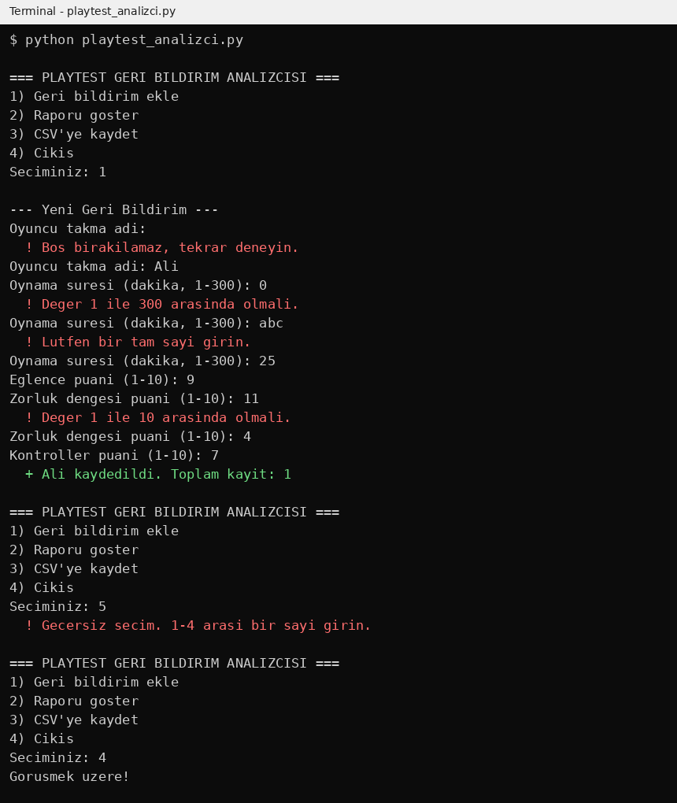
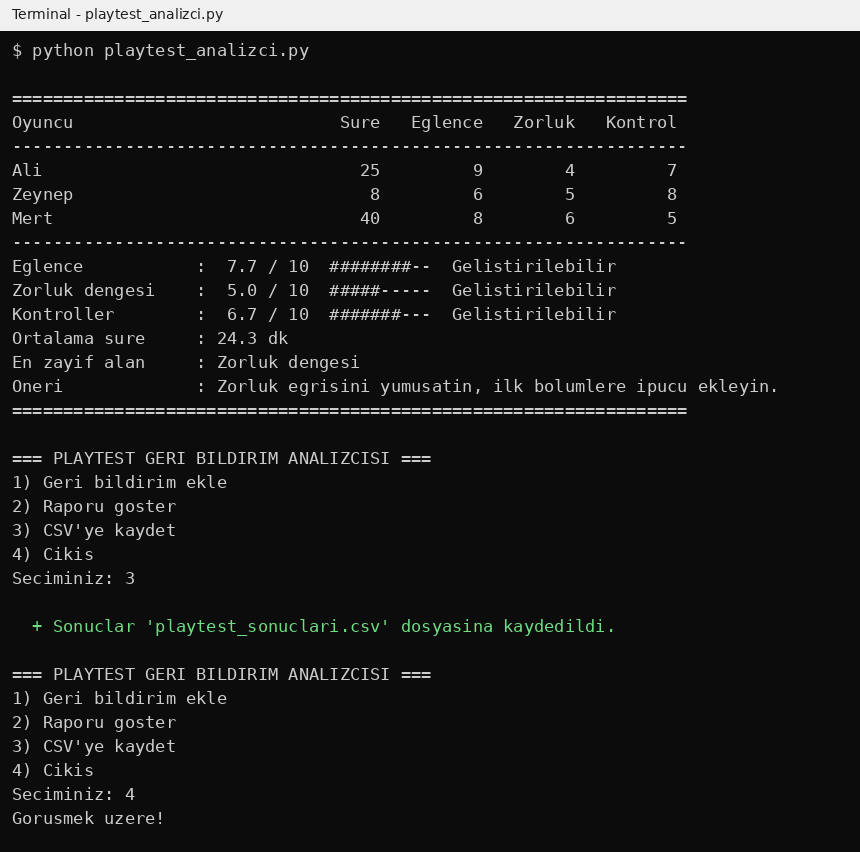
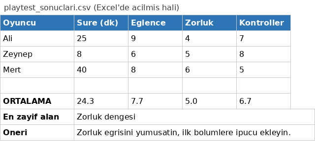
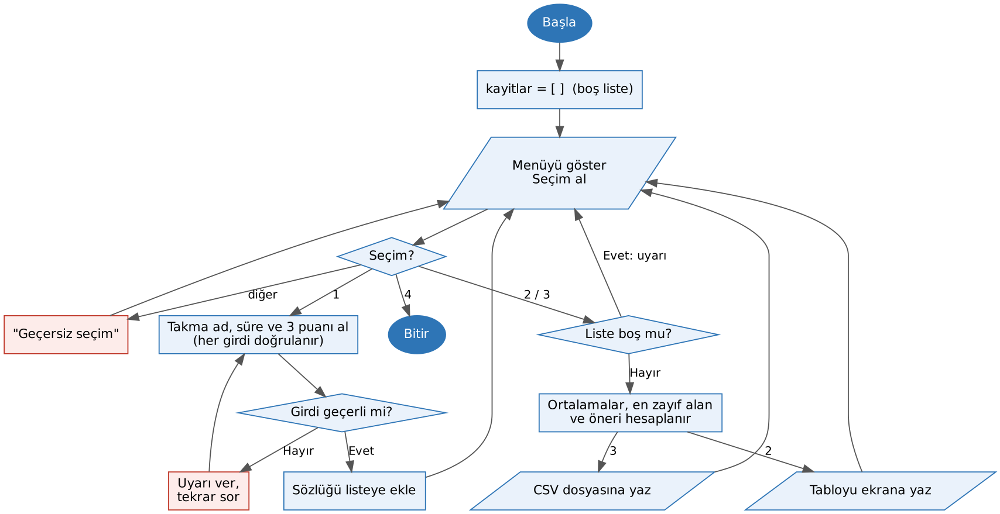

# 🎮 Playtest Geri Bildirim Analizcisi

Bir oyun geliştirme ekibinin playtest (deneme oturumu) sonrasında oyunculardan topladığı puanları analiz eden komut satırı uygulaması.

**GEP1316 Kodlama Okuryazarlığı – Ara Değerlendirme Ödevi 1**
Hazırlayan: Alimert Polat · Dijital Oyun Tasarımı, Bahçeşehir Üniversitesi

---

## Ne işe yarar?

Küçük oyun ekipleri playtest sonrası geri bildirimleri genelde kâğıda ya da dağınık mesajlara yazar, ortalamaları elle hesaplar. Bu program:

- Her oyuncudan **takma ad, oynama süresi** ve **3 alanda 1–10 puan** (Eğlence, Zorluk dengesi, Kontroller) alır
- Hatalı girdileri yakalar, program çökmez, uyarı verip tekrar sorar
- Her alanın ortalamasını, ortalama oynama süresini ve **en zayıf alanı** bulur
- En zayıf alana göre ekibe **kısa bir öneri** yazar
- Sonucu ekrana tablo halinde basar ve **`playtest_sonuclari.csv`** dosyasına kaydeder (Excel'de açılır)

## Nasıl çalıştırılır?

Python 3.8 veya üstü yeterli; ek kütüphane gerekmez.

```bash
python playtest_analizci.py
```

Menüden seçim yapın:

| Seçim | İşlem |
|---|---|
| 1 | Yeni oyuncu geri bildirimi ekle |
| 2 | Raporu ekranda göster |
| 3 | Sonuçları CSV dosyasına kaydet |
| 4 | Çıkış |

## Ekran görüntüleri

**Girdi doğrulama:** boş isim, aralık dışı sayı ve harf girildiğinde program uyarı verir:



**Rapor ve kayıt:**



**CSV çıktısı:**



## Akış şeması



## Kodda kullanılan yapılar

| Gereksinim | Kodda nerede |
|---|---|
| 3+ girdi ve doğrulama | `metin_al()`, `sayi_al()`: `try/except` ve aralık kontrolü |
| 2+ karar yapısı | `puan_yorumu()`, `oneri_uret()`, `ana_menu()` içindeki `if/elif/else` |
| Döngü | `ana_menu()` içindeki `while True` menü döngüsü, girdi tekrar döngüleri |
| 3+ fonksiyon | 11 fonksiyon |
| Liste / sözlük | `kayitlar` listesi, her kayıt bir sözlük; `ALANLAR` sözlüğü |
| Dosyaya kayıt | `csv_kaydet()`: `playtest_sonuclari.csv` |

## Test senaryoları

| # | Girdi | Beklenen | Gerçek | Sonuç |
|---|---|---|---|---|
| 1 | 3 oyuncu, geçerli puanlar → Rapor | Ortalamalar ve en zayıf alan doğru | Eğlence 7.7, Zorluk 5.0, Kontroller 6.7; en zayıf: Zorluk dengesi | ✅ |
| 2 | Süreye `abc` | "Lütfen bir tam sayı girin", tekrar sorar | Aynı | ✅ |
| 3 | Puana `11`, süreye `0` | Aralık uyarısı, tekrar sorar | Aynı | ✅ |
| 4 | Takma ada boş giriş | "Boş bırakılamaz" uyarısı | Aynı | ✅ |
| 5 | Hiç kayıt yokken 2 ve 3 | Çökmez, "Henüz kayıt yok" | Aynı | ✅ |
| 6 | Menüde `5` | "Geçersiz seçim" | Aynı | ✅ |
| 7 | 29 karakterlik takma ad | Tablo hizası bozulmaz | İlk sürümde bozuldu → düzeltildi | ✅ (düzeltme sonrası) |
| 8 | Tüm puanlar eşit (6-6-6) | "En zayıf alan yok" | İlk sürümde yanlışlıkla "Eğlence" → düzeltildi | ✅ (düzeltme sonrası) |

## Dosyalar

```
playtest_analizci.py     # uygulama
README.md                # bu dosya
PROMPTLAR.md             # yapay zekâ ile çalışma günlüğü
ekran_goruntuleri/       # ekran görüntüleri ve akış şeması
```

## Yapay zekâ kullanımı

Bu projede Claude (Anthropic) yardımcı geliştirici olarak kullanıldı. Prompt'lar ve kararlar için: [PROMPTLAR.md](PROMPTLAR.md)

> Anthropic. (2026). *Claude* [Büyük dil modeli]. https://claude.ai
